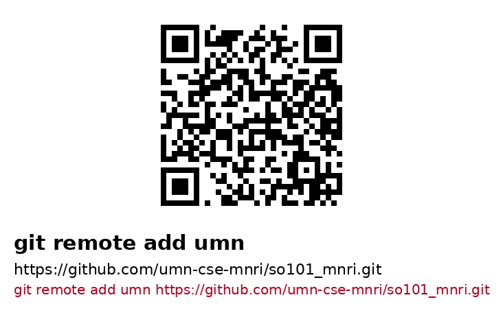

# Remotes: adding the organization remote

Two remotes, and one of them is the one you probably want:

| remote | URL | what it is |
|---|---|---|
| `umn` | `https://github.com/umn-cse-mnri/so101_mnri.git` | **the organization fork** — the branches and the PRs live here |
| `origin` | `https://github.com/thdhyan/so101_mnri.git` | the upstream repo the fork was made from |

## Why HTTPS, not SSH

The `umn-cse-mnri` organization **enforces SAML SSO**. An SSH key that works
fine on the upstream repo is refused on the organization repo unless it has
been authorized for the org:

```
ERROR: The 'umn-cse-mnri' organization has enabled or enforced SAML SSO.
To access this repository, you must use the HTTPS remote with a personal
access token or SSH with an SSH key and passphrase that has been authorized
for this organization.
```

That is the "my GitHub keys don't work" symptom: `ssh -T git@github.com` says
`Hi <user>!` and the *upstream* repo clones over SSH, but the organization
remote still fails, because the key is not authorized for the org.

Both repos are public, so **HTTPS needs no key at all** — the URL is the whole
credential for reading. Over HTTPS the credential is a token, and a token can
be authorized for the org.

Cloning over SSH is still fine when your key works; use the same URL you
already have and swap the scheme:

```bash
git@github.com:umn-cse-mnri/so101_mnri.git      # SSH  (needs an SSO-authorized key)
https://github.com/umn-cse-mnri/so101_mnri.git   # HTTPS (needs nothing to read)
```

## Add the organization remote

Scan the card, or copy the URL out of it:



```bash
git remote add umn https://github.com/umn-cse-mnri/so101_mnri.git
git remote -v
```

```
umn     https://github.com/umn-cse-mnri/so101_mnri.git (fetch)
umn     https://github.com/umn-cse-mnri/so101_mnri.git (push)
origin  https://github.com/thdhyan/so101_mnri.git    (fetch)
origin  https://github.com/thdhyan/so101_mnri.git    (push)
```

If `git remote add umn` says `remote umn already exists`, the remote is
already there — check it with `git remote get-url umn` and move on.

The same card exists for the upstream remote:


```bash
git remote add origin https://github.com/thdhyan/so101_mnri.git
```

## Pushing without an SSH key

Reading over HTTPS needs nothing. Pushing needs a credential, and there are
two ways to get one:

**A token (PAT).** GitHub → Settings → Developer settings → Personal access
tokens → *Tokens (classic)*, with the `repo` scope. A token used on an
SAML-SSO organization must itself be **authorized for the org** (GitHub shows
an "Authorize SSO" button for the token) — an unauthorized token fails with
the same SSO error as an unauthorized key. Then, per push:

```bash
git remote set-url --push umn \
  https://<USER>:<TOKEN>@github.com/umn-cse-mnri/so101_mnri.git
```

Or let git ask for it once and cache it:

```bash
git config --global credential.helper store    # writes the token to ~/.git-credentials
```

**B `gh`.** If the GitHub CLI is installed, it writes the credential helper
for you and you never paste a token into a URL. `gh auth login` runs the
browser flow, which authorizes the token for the SSO org for you:

```bash
gh auth login
gh auth setup-git
git push umn <branch>
```

## Fresh clone

```bash
git clone https://github.com/umn-cse-mnri/so101_mnri.git
cd so101_mnri
git submodule update --init --recursive
```

If you cloned the upstream repo instead and want the organization remote too,
add it as above — that is the whole point of this page.

## Regenerating the QR codes

The PNGs in `docs/qr/` are generated, not hand-drawn:

```bash
.venv/bin/python scripts/make_remote_qr.py             # -> docs/qr/*.png
.venv/bin/python scripts/make_remote_qr.py --out-dir /tmp
```

Needs `qrcode` and `pillow` (`pip install 'qrcode[pil]'`). Edit the `REMOTES`
table at the top of the script if a URL changes, then re-run it and commit the
new PNGs.
